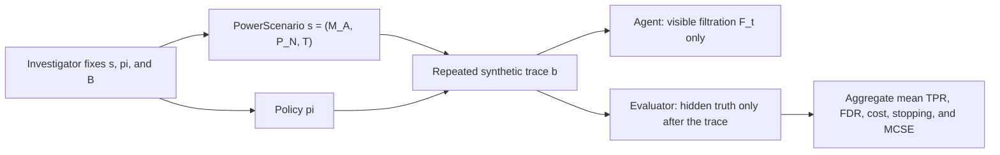

# Investigator, simulated agent, and task-environment perspective

## Direct answer

This package estimates **an investigator-facing operating characteristic of a
declared adaptive-study design**. It does not assign statistical power to an
agent by itself, and it does not estimate performance over an unspecified
real-world niche.

In an action-loop study, the embedded active-inference agent acts under
uncertainty about latent state and context. The investigator first fixes the
agent model, a synthetic task environment, a testing setting, a policy, and a
replication plan. The evaluator then simulates independent traces and uses
hidden truth only after each trace to score the result. The resulting estimate
belongs to that complete design and its stated assumptions.

`Simulated niche` is used only as an informal reader-facing synonym for the
evaluator-side `GenerativeProcessSpec`: hidden truth, context, action-dependent
observations, missingness, reliability, and simulated cost. It is not a new API
object, an ecological claim, an empirical deployment population, or a random
distribution over environments.

The process also hashes `cost_unit` and `cost_scale_id`. They identify the
scenario-local meaning of simulated resource cost $C$; a cost or power-per-cost
comparison across scenarios is meaningful only when both identifiers match.

## Two study lanes, one evaluative perspective

The suite contains two related study lanes. They share the same requirement to
declare a data-generating process, evidence interface, and replication plan, but
only one instantiates an action-conditioned agent--task-environment loop.

| Study lane | What the investigator simulates | What the agent does | What a reported power value describes |
|---|---|---|---|
| Fixed-horizon method and calibration comparison | Declared observation streams, null/alternative laws, calibrated evidence, and named correction procedures. | A posterior may be computed on a fixed stream, but there is no action-controlled task environment to navigate. | The operating characteristic of the declared statistical testing design. It is not an agent or niche score. |
| Action-loop design comparison | A declared model/process/setting plus policy, with action-dependent observations, cost, and stopping. | The embedded agent chooses actions from its visible filtration and therefore faces uncertainty *within* the fixed synthetic process. | The investigator's conditional operating characteristic for that scenario-policy design, estimated across replications. |

Thus “an agent addressing an uncertain niche” describes only the within-trace
mechanics of the action-loop lane, and even there *niche* remains informal
shorthand for a synthetic task environment. “An investigator studying an
agent--task-environment design” describes the estimand-bearing role in both
lanes. Neither lane assigns statistical power to the agent itself.

## Roles and information boundary

The agent does not see evaluator-only truth, future observations, or a
replication aggregate. The investigator is not modeled as a second active
inference agent; the investigator is the study designer and estimator. Fixed-
horizon method/calibration lanes are investigator simulations of declared
statistical procedures and do not instantiate the richer action-loop described
above.

## Formal design and estimands

Let

\[
s=(M_A,P_N,T), \qquad d=(s,\pi),
\]

where \(M_A\) is the agent-side generative model, \(P_N\) is the evaluator-
side synthetic task environment, \(T\) is the testing setting, and \(\pi\) is
the separately recorded executed policy. The serialized `PowerScenario` hash
binds those scientific components plus scenario identity and claim metadata;
it does not bind a separately supplied surface policy. Its setting supplies a
default stopping rule only when an action policy is omitted. A release
operating row has the immutable identity `(scenario_id, scenario_hash, policy)`.

For the action-loop surface, reported power is the expected replication-level
true-positive rate (TPR):

\[
\theta_{\mathrm{TPR}}(d)=
\mathbb E_{P_N,U_\pi}\!\left[
\frac{|\mathcal R_d\cap\mathcal H_1(P_N)|}
{\max\{1,|\mathcal H_1(P_N)|\}}
\right],
\qquad
\widehat\theta_B(d)=\frac{1}{B}\sum_{b=1}^{B}\mathrm{TPR}_b.
\]

Here \(U_\pi\) denotes the policy and trace randomization used by \(\pi\);
the evaluator-side process randomness is represented by \(P_N\).

The implementation also reports the different event
\(\Pr(|\mathcal R_d\cap\mathcal H_1|>0)\) as
`any_true_rejection_rate`. It must not be substituted for mean TPR without a
newly stated estimand. Monte-Carlo standard error (MCSE) describes precision of
\(\widehat\theta_B(d)\), not uncertainty about an undeclared population of
environments.

## What the scenario grid does not mean

The declared scenario grid is a sensitivity comparison, not a probability
distribution over niches. A niche-averaged quantity such as
\(\mathbb E_{s\sim\nu}[\theta_{\mathrm{TPR}}(s,\pi)]\) would require a
predeclared and externally justified distribution \(\nu\), weights, sampling
frame, and validation evidence. The current suite does not define or estimate
that object.

Likewise, a policy comparison is a model-based intervention within the
specified synthetic process. It is not a causal claim about a deployed agent,
an optimality theorem, or evidence of ecological adaptation.

## Implementation map

- `scenario.PowerScenario` holds and hashes the model, process, and setting.
- `action_loop.evaluate_power_surface` evaluates the Cartesian product of
  scenarios and policies.
- `schema._current_row_identity` binds a result row to scenario ID, scenario
  hash, and policy.
- `action_statistics.metrics_for_trace` computes replication-level TPR using
  evaluator-only truth after a trace has stopped.
- The scenario-decomposition figure and its registry metadata expose the same
  role separation in the manuscript, dashboard, and accessible figure bundle.

## Evidence and accounting field contract

Publication-facing JSON names a likelihood-ratio evidence quantity as an
`e_process_value` (one action step), `e_process_values` (a sequential path),
or `terminal_e_process_value` (a completed trace). Target-indexed values use
`target_e_process_values`, and log-domain paths use
`log_e_process_values`. These fields are dimensionless evidence values; they
are not a resource budget or a policy utility.

Online multiple-testing traces instead serialize an `accounting_path` together
with a required `accounting_kind`: `procedural_alpha_wealth` for LORD++ or
SAFFRON, and `cumulative_nominal_level_allocation` for e-LOND. e-LOND's path
is the cumulative sum of emitted nominal levels, not remaining alpha: recycled
levels can make it exceed $\alpha$. This makes a raw result as unambiguous as
its axes and captions: an e-process field is never silently interpreted as
alpha accounting, and an accounting path is never silently interpreted as
likelihood-ratio evidence.

See [action-in-the-loop](action_in_the_loop.md),
[the package contract](PACKAGE_CONTRACT.md), and
[visualization notes](visualization_notes.md) for the corresponding execution,
API, and presentation contracts.
